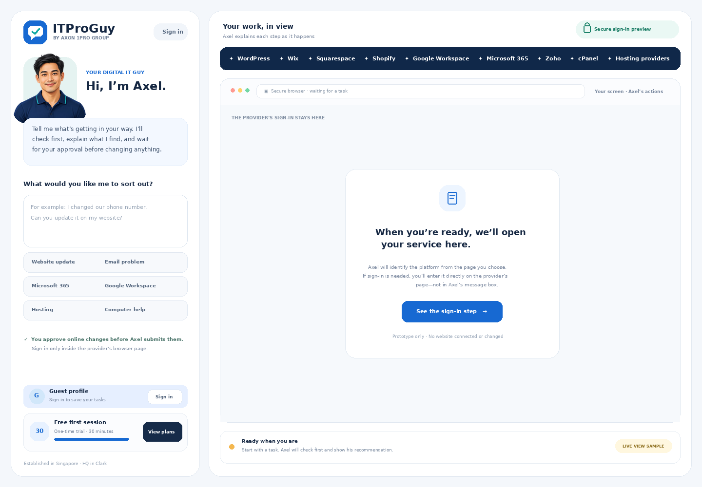

# ITProGuy

**ITProGuy** is a guided digital-operations assistant for everyday business tasks. Users explain what they need in plain English; Axel checks first, explains the finding, and waits for approval before making supported changes.

## Repository

- [`BLUEPRINT.md`](BLUEPRINT.md) — product, safety, platform, pricing, and rollout plan.
- [`DEPLOYMENT-PLAN.md`](DEPLOYMENT-PLAN.md) — phased delivery plan and current status.
- [`index.html`](index.html) — self-contained interactive homepage/workspace prototype. It is a visual demo only; sign-in, AI, payments, and provider actions are not connected.
- [`assets/itproguy-logo.svg`](assets/itproguy-logo.svg) — scalable brand wordmark.
- [`assets/axel-avatar.webp`](assets/axel-avatar.webp) — generated mascot concept for Axel.

## Brand direction

**Axel, your IT Pro Guy by Axon 1Pro Group**  
Established in Singapore, with headquarters in Clark.

The product is designed for non-technical business users: a task-first workspace, plain-language findings, a visible browser, and explicit approval before online changes. It is not a general-purpose chatbot or image generator.

## Preview

Open `index.html` in a browser to view the local prototype. No backend, account, API key, or customer data is required.

## Current status

Phase 1 is live at [itproguy.com](https://itproguy.com) and [www.itproguy.com](https://www.itproguy.com) on the German staging server, using a dedicated static site folder and Apache virtual host. Both names have a valid Let's Encrypt certificate; HTTP redirects to HTTPS, and a renewal dry run succeeded. The workspace fills the browser width.

This is still a visual preview: customer sign-in, AI/API integration, billing, and live browser automation are not connected.

See [`DEPLOYMENT-PLAN.md`](DEPLOYMENT-PLAN.md) for the phase gates and current server status.
